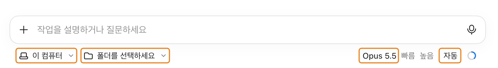

# 작업 폴더와 비공개 저장소 준비 가이드

교재: 1.1절 사흘간의 과목 흐름 (8~9쪽) · 1.9절 내일의 입력 준비 (25~26쪽) · 부록 A-1 작업 폴더와 비공개 저장소 (50~51쪽) · 쓰는 날: Day 1 오전, Day 1 끝, 그리고 하루를 마칠 때마다 · 쓰는 곳: GitHub 비공개 저장소 `personal-brand-site`와 내 컴퓨터의 작업 폴더 `personal-brand-site/`

## 이 가이드에서 볼 것

사흘 동안의 결과물은 두 곳에 둡니다. 수업 중에는 내 컴퓨터의 **작업 폴더**에서 일하고, 하루를 마칠 때마다 GitHub의 **비공개 저장소**에 올립니다. 이 가이드는 교재 1.1절 [실습 안내] · 1.9절 [실습 안내] · 부록 A-1의 흐름을 실제 화면의 버튼 이름과 위치로 따라갑니다.

- Git 명령(개발자가 터미널에서 쓰는 명령)은 쓰지 않고 github.com 웹 화면에서만 작업합니다.
- Mac과 Windows의 GitHub 화면은 같고 단축키만 다릅니다(Mac `Cmd` = Windows `Ctrl`).
- 비공개 저장소와 3.3절에서 만드는 **공개 주소**는 다른 것입니다. 저장소에는 이력서와 워크시트까지 모두 올리고 강사 `wild-mental`만 봅니다. 공개 주소에는 사이트 파일만 올립니다(「[공개와 배포 가이드](publish-deploy-guide.md)」).

| 순서 | 하는 일 | 언제 |
|---|---|---|
| 1 | 비공개 저장소 만들고 `worksheet.md` 붙여 넣기 | Day 1 오전 (1.1) |
| 2 | 강사 초대 | Day 1 오전 (1.1) |
| 3 | 작업 폴더에 `resume.md` · `worksheet.md` 넣기 | Day 1 오전 (1.1) |
| 4 | Claude Code에서 작업 폴더 열고 「작업 폴더 준비 지시문」 보내기 | Day 1 오전 (1.1) |
| 5 | `DESIGN.md` 복사, 뼈대 페이지 만들기 | Day 1 끝 (1.9) |
| 6 | 저장소에 올리기 | 하루를 마칠 때마다 |

## 두 곳 한눈에

| | 작업 폴더 | 비공개 저장소 |
|---|---|---|
| 어디에 | 내 컴퓨터 (바탕화면이나 문서 폴더) | github.com 내 계정 |
| 이름 | `personal-brand-site/` | `personal-brand-site` (**Private**) |
| 무엇을 | Claude Code가 이 폴더를 열고 파일을 만들고 고칩니다. `worksheet.md`도 여기서 채웁니다 | 하루를 마칠 때마다 작업 폴더의 파일을 올려 두는 곳. 강사 `wild-mental`이 봅니다 |

사흘이 끝났을 때 작업 폴더 안의 모양입니다(교재 1.1절 · 부록 A-1, 지시문 킷과 같음).

```text
personal-brand-site/
├── resume.md                      ← 텍스트 이력서 (사전 과제)
├── worksheet.md                   ← 자료실 원본의 워크시트를 복사한 것
├── DESIGN.md                      ← 나만의 DESIGN.md 사본 (1.9), 룩앤필 규칙 덧붙임 (2.3)
├── index.html                     ← 내 사이트 (1.9부터)
├── index-day1.html                ← 「첫 화면 지시문」이 남기는 어제의 복사본 (2.2)
├── index-before-lookfeel.html     ← 「룩앤필 지시문」이 남기는 복사본 (2.3)
├── images/                        ← 사진 · 화면 캡처 · 생성 이미지 · 영상 (2.4 · 2.5)
└── public/                        ← 공개할 파일만 모은 폴더 (3.3)
    ├── index.html
    └── images/
```

폴더와 파일 이름은 모두 영문 소문자로, 위와 똑같이 씁니다. 지시문 킷의 지시문이 이 이름으로 파일을 찾습니다. `DESIGN.md`만 대문자입니다.

**`worksheet.md`는 작업 폴더에서만 고칩니다.** 저장소는 하루를 마칠 때 올려 두는 곳입니다. GitHub 웹 화면에서 `worksheet.md`를 고치면, 저녁에 작업 폴더의 `worksheet.md`를 올릴 때 이름이 같아 그 고친 내용이 덮여 사라집니다. 저장소에서 파일을 열었을 때 보이는 연필 아이콘(파일 고치기)은 누르지 않습니다.

## 1. 비공개 저장소 만들기 (처음 한 번)

1. github.com에 로그인하고 오른쪽 위 **+** 단추 → **New repository**를 누릅니다.
2. **Repository name**에 `personal-brand-site`를 씁니다. 공개 범위 선택에서 반드시 **Private**(비공개)를 고릅니다. README 추가 같은 나머지 선택 항목은 건드리지 않고 **Create repository**를 누릅니다.
3. 새 탭에서 워크시트 원본을 엽니다. 자료실 첫 화면의 워크시트 링크를 누르거나 여기 [`worksheet.md` 원본](https://github.com/wild-mental/ax-wave-personal-brand-wildmental/blob/main/worksheet-template/worksheet.md)을 누르면 **자료실 원본**(GitHub 화면)에서 열립니다.
4. 파일 내용 위쪽 막대 오른쪽에 아이콘이 나란히 있습니다. 왼쪽부터 **Raw**(글자로 적힌 버튼, 꾸밈 없이 글만 보는 화면) · **Copy raw file**(네모 두 개가 겹친 복사 아이콘, 전체 복사) · **Download raw file**(아래 화살표 모양의 내려받기 아이콘, 파일로 내려받기)입니다. 그 오른쪽의 연필 아이콘은 누르지 않습니다. **Copy raw file**을 누릅니다. 눈에 띄는 변화가 없어도 내용 전체가 복사된 것입니다.
5. 내 저장소 탭으로 돌아옵니다. 방금 만든 빈 저장소라면 안내 문구 가운데 **creating a new file** 링크를, 이미 파일이 있다면 **Add file → Create new file**을 누릅니다.
6. 위쪽 이름 칸에 `worksheet.md`를 씁니다. 아래 편집 칸을 한 번 누르고 `Cmd+V`(Windows `Ctrl+V`)로 붙여 넣습니다.
7. 오른쪽 위 **Commit changes...** → 뜨는 상자에서 **Commit changes**를 누릅니다. 저장소 첫 화면에 `worksheet.md`가 보이면 됩니다.

이 버튼들은 github.com 화면에만 있고, 자료실(`wild-mental.github.io`) 화면에는 없습니다.

## 2. 강사 초대

1. 내 저장소 위쪽 탭의 **Settings**를 누릅니다. 창이 좁으면 탭 줄 끝의 **⋯** 안에 있습니다.
2. 왼쪽 메뉴 Access 아래 **Collaborators**를 누르고 **Add people**을 누릅니다. 비밀번호나 인증을 다시 물으면 입력합니다.
3. 검색 칸에 `wild-mental`을 쓰고, 목록에서 아이디가 정확히 `wild-mental`인 항목을 고른 뒤 **Add wild-mental to this repository**를 누릅니다.

목록에 `wild-mental`이 **Pending invite**(수락 대기)로 보이면 여러분이 할 일은 끝났습니다. 강사가 수락하면 대기 표시가 사라집니다.

## 3. 작업 폴더에 두 파일 넣기

사전 안내대로 했다면 바탕화면이나 문서 폴더에 `personal-brand-site` 폴더가 있고, 그 안에 텍스트 이력서 `resume.md`가 있습니다. 여기에 `worksheet.md`를 더합니다.

1. 파일 확장자가 보이게 설정합니다(아래 표). 그래야 `worksheet.md.txt`처럼 잘못 붙은 이름을 알아챌 수 있습니다.
2. 내 저장소에서 `worksheet.md`를 눌러 열고, 파일 위쪽 막대의 **Download raw file**(내려받기 아이콘)을 누릅니다.
3. 내려받은 파일은 보통 **다운로드** 폴더에 저장됩니다. 그 파일을 `personal-brand-site` 폴더로 끌어다 놓아 옮깁니다.
4. 폴더 안의 파일 이름이 정확히 `resume.md`와 `worksheet.md`인지 봅니다. `worksheet (1).md`나 `resume.md.txt`처럼 되어 있으면 이름을 고칩니다.

| | Mac | Windows |
|---|---|---|
| 새 폴더 (폴더가 아직 없을 때) | Finder에서 바탕화면을 열고 **파일 → 새로운 폴더**(`Cmd+Shift+N`) | 파일 탐색기에서 바탕화면을 열고 빈 곳 오른쪽 클릭 → **새로 만들기 → 폴더**(`Ctrl+Shift+N`) |
| 이름 바꾸기 | 폴더나 파일을 고르고 `Return` | 폴더나 파일을 고르고 `F2` |
| 확장자 보이게 하기 | **Finder → 설정 → 고급 → 모든 파일 확장자 보기** 켜기 | 파일 탐색기 **보기 → 표시 → 파일 이름 확장명** 켜기 |
| 내려받은 파일 찾기 | Finder 왼쪽 목록의 **다운로드** | 파일 탐색기 왼쪽 목록의 **다운로드** |
| `.md` 파일 열어 고치기 | 오른쪽 클릭 → **다음으로 열기 → 텍스트 편집기** | 오른쪽 클릭 → **연결 프로그램 → 메모장** |

`resume.md`를 아직 쓰지 못했다면 「[텍스트 이력서 작성 가이드](text-resume-guide.md)」 1번대로 양식을 받아 같은 폴더에 두고, 1 · 2 · 3 · 7번만 먼저 채웁니다.

## 4. Claude Code에서 작업 폴더 열기

1. Claude 데스크톱 앱을 열고 위쪽의 **Code** 탭을 누릅니다.
2. 입력창 아래 줄을 봅니다. 왼쪽에 **환경 선택**(처음에는 '이 컴퓨터')과 **폴더 선택**(처음에는 '폴더를 선택하세요')이 있고, 오른쪽에 모델 이름이 보이는 **모델 선택**과 **모드 선택**이 있습니다.



3. **환경 선택**에서 내 컴퓨터(**이 컴퓨터**)를 고릅니다.
4. **폴더 선택**을 누르고 `personal-brand-site` 폴더를 고릅니다. 하위 폴더(`images` 등)가 아니라 맨 위 폴더를 고릅니다. Mac에서 Claude가 '데스크탑'(또는 '문서') 폴더의 파일에 접근하려 한다는 창이 뜨면 **허용**을 누릅니다.
5. **모드 선택**은 앞 과목에서 쓰던 대로 둡니다. 처음이라면 파일을 만들거나 고치기 전에 허락을 묻는 모드를 고릅니다. **모델 선택**은 기본 모델 그대로 둡니다. 빠른 응답용 · 경량 모델로 바꾸지 않습니다.
6. 지시문 킷의 「[작업 폴더 준비 지시문](../kits/claude-code-prompts.md)」 코드 상자 안의 글을 통째로 복사해 입력창에 붙여 넣고 보냅니다. 교재 1.1절의 지시문 상자는 줄인 것이니 늘 킷의 전문을 씁니다.
7. 폴더를 만들어도 되는지 묻는 창이 뜨면, 만들 곳이 `personal-brand-site` 안인지 보고 허락합니다.

**이렇게 나오면 정상입니다.**

- Claude Code가 `resume.md`와 `worksheet.md` 두 파일 이름을 알려 줍니다.
- 작업 폴더 안에 `images/` 폴더가 생겼습니다. Finder(Windows는 파일 탐색기)에서 작업 폴더를 열어 직접 봅니다. 폴더는 아직 비어 있습니다.

**다를 때.**

- 파일이 없다고 한다 → 폴더 선택에서 다른 폴더(다운로드 폴더나 하위 폴더)를 열었거나, 파일 이름이 다릅니다. 이 절의 4번과 3번의 4를 다시 봅니다.
- `images` 폴더가 엉뚱한 곳에 생겼다 → "방금 만든 images 폴더가 어디에 있는지 전체 경로로 알려 줘."라고 묻습니다. `personal-brand-site` 바로 아래가 아니면 폴더 선택을 다시 하고 지시문을 다시 보냅니다.
- 없는 파일을 새로 만들겠다고 한다 → 허락하지 않습니다. 이력서와 워크시트는 내가 넣는 파일입니다. 3번으로 돌아가 파일을 넣고 다시 보냅니다.

## 5. Day 1 끝: DESIGN.md 복사와 뼈대 페이지 (1.9)

### 나만의 DESIGN.md를 작업 폴더에 넣기

1. 사전 안내 6번에서 내려받아 둔 나만의 DESIGN.md(앞 과목에서 만든 내 디자인 규칙 문서)를 찾습니다.
2. 그 파일을 복사해 `personal-brand-site` 맨 위(`resume.md` · `worksheet.md`가 보이는 곳)에 붙여 넣습니다(Mac `Cmd+C` → `Cmd+V`, Windows `Ctrl+C` → `Ctrl+V`).
3. 붙여 넣은 파일의 이름을 정확히 `DESIGN.md`로 바꿉니다. 앞 과목에서 `my-own-DESIGN.md`처럼 다른 이름으로 저장했다면 사본의 이름만 바꿉니다. 원본은 그대로 둡니다.
4. 이름이 `DESIGN.md.txt`나 `DESIGN (1).md`가 되지 않았는지 봅니다.

파일이 없다면 Claude Code에 "DESIGN.md를 새로 만들어 줘. 흰 바탕, 짙은 남색 글자, 강조색 하나만 쓰는 깔끔한 규칙으로 색 · 글꼴 · 여백만 짧게 적어 줘."라고 보내 기본 규칙을 하나 만들고 씁니다. 2.3절에서 이 파일에 이 사이트의 규칙을 덧붙입니다.

### 뼈대 페이지 만들기

1. 오늘 채운 워크시트를 저장했는지 봅니다(텍스트 편집기 · 메모장에서 `Cmd+S` · `Ctrl+S`).
2. 지시문 킷의 「[뼈대 페이지 지시문](../kits/claude-code-prompts.md)」을 복사해 보냅니다.
3. 만들어진 `index.html`을 Chrome으로 끌어다 놓거나 두 번 눌러 엽니다(교재 부록 A-3).

**이렇게 나오면 정상입니다.**

- 작업 폴더에 `index.html`이 생겼고, 브라우저로 열면 색과 꾸밈이 거의 없는 흰 페이지가 위에서 아래로 길게 나옵니다.
- 섹션이 「순서와 시각화 전략표」의 순서대로 나오고, 섹션마다 머리에 계층별 슬로건이, 아래에 근거 문장 한두 줄이 있습니다.
- 사진 자리는 회색 상자이고, 상자 안에 무엇이 들어갈지 적혀 있습니다.
- 섹션 끝에 '미디어 · 연출'과 '인상'을 적은 메모 상자가 있습니다.

위에서 아래로 한 번 읽고, 순서가 어색한 곳 한 군데를 고칩니다. 고치는 순서와 다시 지시하는 말은 「[Claude Code 사이트 제작 가이드](claude-code-site-guide.md)」를 봅니다. 워크시트에 없는 경력이나 숫자가 페이지에 보이면 "워크시트에 없는 내용이 들어간 곳을 모두 찾아 지워 줘. 다른 곳은 고치지 마."라고 보냅니다.

## 6. 하루를 마칠 때: 저장소에 올리기

1. Claude Code가 작업 중이면 끝날 때까지 기다립니다. 직접 고치던 파일(`worksheet.md` 등)이 있으면 저장합니다.
2. 내 저장소 첫 화면에서 **Add file → Upload files**를 누릅니다.
3. Finder(Windows는 파일 탐색기)에서 작업 폴더를 **열고**, 그 **안의** 파일과 폴더를 모두 골라 브라우저의 끌어다 놓는 칸에 놓습니다. 폴더 안에서 Mac `Cmd+A`(Windows `Ctrl+A`)를 누르면 모두 골라집니다. 작업 폴더 자체를 끌어다 놓지 않습니다.
4. 올라갈 파일 목록이 보이면 아래쪽의 **Commit changes**를 누릅니다. 같은 이름의 파일은 새 내용으로 바뀝니다.
5. 저장소 첫 화면에서 오늘 만든 파일(Day 1은 `index.html` · `DESIGN.md`, Day 2는 `images` 폴더 안의 파일)이 있는지 봅니다.
6. 저장소 이름 옆에 **Private** 표시가 있는지, Settings → Collaborators에 `wild-mental`이 있는지 봅니다.

알아 둘 것:

- **빈 폴더는 올라가지 않습니다.** Day 1에는 `images/`가 비어 있으므로 저장소에 보이지 않는 것이 정상입니다.
- **한 번에 올릴 수 있는 양에 한도가 있습니다.** 웹 화면에서는 한 번에 100개까지, 파일 하나는 25MB까지 올라갑니다. 영상 파일이 25MB를 넘으면 그 파일만 올라가지 않습니다. 사이트에 넣을 영상은 짧게 줄여 쓰는 편이 좋습니다(「[움직임 넣기 가이드](motion-guide.md)」).
- **둘째 날 · 셋째 날에도 같은 방법으로 모두 다시 올립니다.** 이미 올린 파일은 새 내용으로 바뀌고, 지난 내용은 그 파일 화면 오른쪽 위 **History**(시계 아이콘)에 남습니다.
- `public/` 폴더(3.3절)도 함께 올라가도 괜찮습니다. 이 저장소는 비공개입니다.

## 자주 하는 실수와 고친 예

- **저장소를 Public으로 만들었다** → 이력서와 워크시트가 누구에게나 보입니다. Settings 맨 아래 **Danger Zone**의 **Change visibility**를 누르고 private을 고른 뒤, **I have read and understand these effects** → **Make this repository private**까지 누릅니다. 저장소 이름 옆 표시가 **Private**으로 바뀌었는지 봅니다.
- **이름 철자가 다르다** (`personal-brand`, `Personal-Brand-Site`, `personal brand site`) → 저장소 이름은 Settings 첫 화면(General)의 Repository name 칸에서 고치고 **Rename**을 누릅니다. 작업 폴더의 이름은 Finder · 파일 탐색기에서 고칩니다.
- **이력서를 `이력서.md`나 `resume.docx`로 두었다** → 지시문은 `@resume.md`로 찾습니다. 워드 파일이라면 내용을 복사해 「[텍스트 이력서 작성 가이드](text-resume-guide.md)」의 양식에 옮기고, 이름을 `resume.md`로 맞춥니다.
- **GitHub 웹 화면에서 `worksheet.md`를 고친 뒤 작업 폴더의 옛 파일을 올려 덮어썼다** → 저장소의 `worksheet.md` 화면 오른쪽 위 **History**를 누르고, 덮어쓰기 바로 앞의 저장 기록을 엽니다. 빨간 줄(지운 것)로 보이는 글을 복사해 작업 폴더의 `worksheet.md`에 붙여 넣고 다시 올립니다. 앞으로는 작업 폴더에서만 고칩니다.
- **작업 폴더 자체를 끌어다 놓아 한 단계 깊은 폴더가 생겼다** (저장소에 `personal-brand-site/index.html`) → 작업 폴더를 열고 그 **안의** 파일과 폴더를 모두 다시 올립니다. 저장소 맨 위에 `resume.md` · `worksheet.md` · `index.html`이 있으면 되고, 안쪽에 잘못 생긴 폴더는 그대로 두어도 됩니다.

## 제대로 됐는지 확인

- [ ] 저장소 이름이 `personal-brand-site`이고 이름 옆에 **Private** 표시가 있다 (로그아웃한 창(시크릿 창)에서 저장소 주소를 열면 404가 뜬다)
- [ ] 저장소에 `worksheet.md`가 있고, 열면 「개인 브랜드 웹서비스 기획·구현 · 워크시트」 제목이 보인다
- [ ] Settings → Collaborators에 `wild-mental`이 수락 대기 또는 수락된 상태로 있다
- [ ] 내 컴퓨터의 `personal-brand-site/` 안에 `resume.md` · `worksheet.md` · `images/`가 있다
- [ ] Day 1 끝에 `DESIGN.md`와 뼈대 `index.html`이 작업 폴더에 있고, 저장소에도 올라갔다

워크시트 「Day 1 뼈대 페이지」의 **완료 기준 체크리스트**도 하나씩 확인하고 `- [ ]`를 `- [x]`로 바꿉니다.

## 막혔을 때

- **Copy raw file 아이콘이 안 보입니다.** 창이 좁으면 아이콘이 숨습니다. 창을 넓히거나, **Raw**를 눌러 열린 글 화면에서 `Cmd+A` → `Cmd+C`(Windows `Ctrl+A` → `Ctrl+C`)로 복사합니다. 자료실(`wild-mental.github.io`) 화면을 보고 있다면 첫 화면의 워크시트 링크로 GitHub 화면을 엽니다.
- **Settings 탭이 없습니다.** 창이 좁으면 위쪽 탭 끝의 **⋯** 안에 있습니다. 그래도 없으면 내 저장소가 아니라 자료실 원본(이 자료실의 GitHub 화면)을 보고 있는 것입니다. 주소에 내 아이디와 `personal-brand-site`가 있는지 봅니다.
- **`wild-mental`이 검색되지 않거나 초대가 사라졌습니다.** 철자(가운데 하이픈)를 확인합니다. 초대는 7일 안에 수락되지 않으면 사라지므로, 목록에 없으면 다시 초대합니다.
- **Download raw file을 눌렀더니 파일이 저장되지 않고 글 화면이 열립니다.** 그 화면에서 `Cmd+S`(Windows `Ctrl+S`)로 작업 폴더에 저장합니다. 저장한 뒤 이름이 `worksheet.md`인지, 끝에 `.txt`가 붙지 않았는지 확인합니다.
- **Upload files에 폴더가 끌려가지 않거나 폴더 안 파일이 올라가지 않습니다.** 다른 브라우저로 다시 해 봅니다. 저장소에 이미 그 폴더가 있다면, 저장소에서 그 폴더를 눌러 들어간 뒤 **Add file → Upload files**로 그 안의 파일만 골라 올려도 됩니다.
- **파일 하나가 올라가지 않습니다.** 25MB가 넘는 파일입니다. 영상이면 더 짧게 줄인 파일로 바꾸고, 사진이면 크기를 줄입니다(「[룩앤필과 이미지 가이드](lookfeel-image-guide.md)」).

수업 전에 혼자 하다 막힌 단계는 표시해 두고 첫날 수업 시작 전에, 수업 중에는 손을 들어 현장에서 함께 해결합니다.

화면 확인 날짜: 2026-11-22
